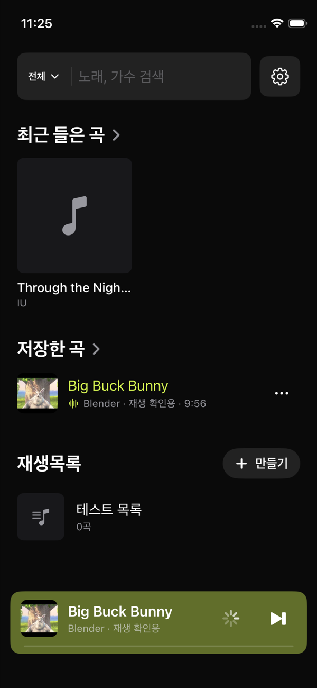
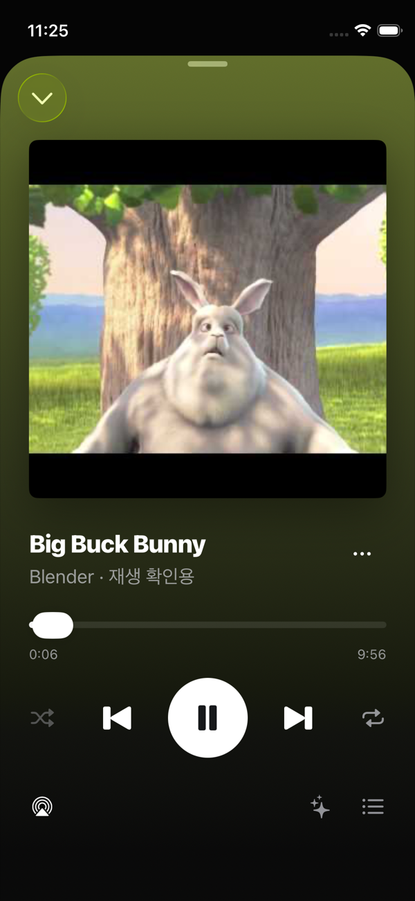

# Sway

[English](README.md) · 한국어

**검색한 곡을 모아 듣는 개인용 음악 앱입니다. iPhone과 Android에서 영상 없이 소리만 재생합니다.**

> [!NOTE]
> 스토어에 올리지 않은 앱입니다. iPhone은 소스를 직접 빌드해 설치하고, Android는 소스를 빌드하거나 Releases의 설치 파일(APK, 디버그 서명)을 씁니다. iOS 17 이상, Android 9 이상에서 동작합니다.

<p>
  
  
</p>

## 쓰는 법

검색창에서 노래나 가수를 찾아 곡을 누르면 바로 재생됩니다. 곡 옆의 메뉴로 보관함이나 재생목록에 담습니다. 아래 미니플레이어를 누르면 재생 화면이 열리고, 셔플·반복·대기열과 비슷한 곡을 이어 듣는 알고리즘을 켤 수 있습니다. 화면을 꺼도 재생이 이어집니다.

들은 곡은 기기에 남겨 다시 들을 때 데이터를 쓰지 않습니다(설정에서 한도를 고르거나 끌 수 있습니다). Android는 재생목록 단위로 Wi-Fi에서 미리 받아 두는 기능도 있습니다.

화면은 검정 바탕 하나이고, 색은 재생 중인 곡의 표지에서 가져옵니다.

## 빌드

### iPhone

Xcode와 [XcodeGen](https://github.com/yonaskolb/XcodeGen)이 필요합니다.

```sh
xcodegen generate
open Sway.xcodeproj
```

Xcode에서 Signing Team을 본인 계정으로 고른 뒤 `Sway` scheme을 iPhone에 실행합니다. 무료 Apple ID로 설치한 앱은 7일마다 다시 설치해야 합니다.

### Android

JDK 17과 Android SDK 36이 필요합니다.

```sh
cd android
./gradlew :app:assembleDebug
adb install -r app/build/outputs/apk/debug/app-debug.apk
```

## 알아 둘 점

- 로그인·서버·광고·사용 기록 수집이 없습니다. 보관함과 재생목록은 기기에만 저장되고, 앱을 지우면 사라집니다.
- 음원은 YouTube의 비공식 경로로 가져옵니다. YouTube 쪽이 바뀌면 검색이나 재생이 안 될 수 있습니다.
- YouTube 서비스 약관은 공식 플레이어 밖의 재생과 저장을 허용하지 않습니다. 사용에 따른 책임은 쓰는 사람에게 있습니다.

## Feedback

제가 이런 분야를 접한 지 얼마 안 돼서 부족한 점이 많습니다. 고칠 점이나 알려주실 내용이 있다면 issue나 PR로 남겨주시면 너무 감사하겠습니다.

## License

이 저장소의 코드는 [MIT](LICENSE)입니다. 함께 들어 있거나 빌드에 쓰는 다른 프로젝트는 각자의 라이선스를 따릅니다.

- [YouTubeKit](https://github.com/alexeichhorn/YouTubeKit) (MIT): `Vendor/YouTubeKit`에 고친 사본이 들어 있습니다. 고친 내용은 `Vendor/YouTubeKit/SWAY_PATCHES.md`에 있습니다.
- [NewPipeExtractor](https://github.com/TeamNewPipe/NewPipeExtractor) (GPL-3.0): Android 판이 씁니다. 그래서 Android 설치 파일은 GPL-3.0 조건으로 배포됩니다.
- Galmuri 글꼴 (SIL OFL 1.1): iPhone 판에 들어 있습니다.
