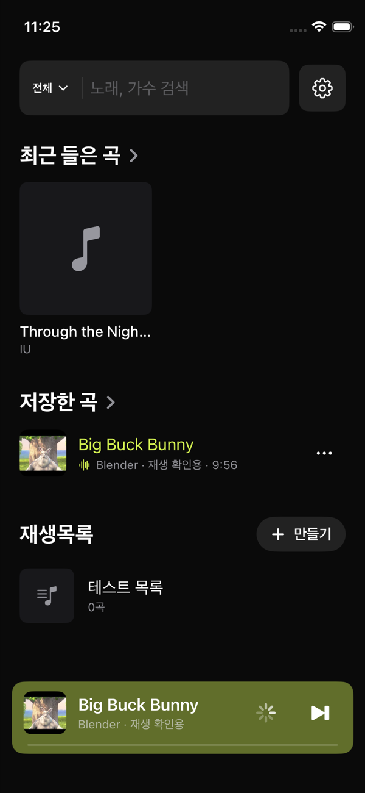
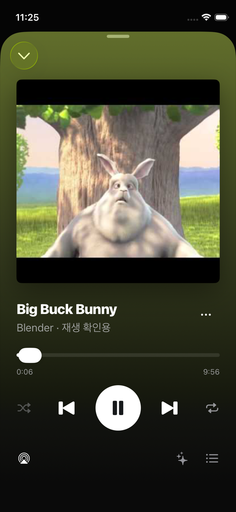

# Sway

English · [한국어](README.ko.md)

**A personal music app for collecting and listening to songs you search for. It plays audio only, without video, on iPhone and Android.**

> [!NOTE]
> This app is not on any store. On iPhone you build and install it from source. On Android you build from source or use the APK from Releases (debug-signed). It runs on iOS 17 or later and Android 9 or later. The app's interface is in Korean only.

<p>
  
  
</p>

## How to use

Search for a song or artist and tap a track to play it. Use the menu next to a track to add it to your library or a playlist. Tap the mini player at the bottom to open the player, where you can use shuffle, repeat, the queue, and a mix mode that keeps playing similar songs. Playback continues with the screen off.

Songs you have listened to are kept on the device so that replaying them uses no data (you can choose the limit or turn this off in settings). On Android you can also download a whole playlist over Wi-Fi in advance.

The interface uses a single black theme, and its colors come from the artwork of the song that is playing.

## Build

### iPhone

You need Xcode and [XcodeGen](https://github.com/yonaskolb/XcodeGen).

```sh
xcodegen generate
open Sway.xcodeproj
```

In Xcode, choose your own account as the Signing Team, then run the `Sway` scheme on your iPhone. An app installed with a free Apple ID has to be reinstalled every 7 days.

### Android

You need JDK 17 and Android SDK 36.

```sh
cd android
./gradlew :app:assembleDebug
adb install -r app/build/outputs/apk/debug/app-debug.apk
```

## Good to know

- There is no login, server, advertising, or usage tracking. Your library and playlists are stored only on the device and are lost if you delete the app.
- Audio is fetched through unofficial YouTube endpoints. Search or playback may stop working when YouTube changes something.
- The YouTube Terms of Service do not allow playback or saving outside the official player. You are responsible for how you use this app.

## Feedback

I am fairly new to this field, so there is a lot I can improve. If you find something to fix or have something to share, I would really appreciate an issue or a PR.

## License

The code in this repository is under the [MIT](LICENSE) license. Other projects that are bundled or used in the build keep their own licenses.

- [YouTubeKit](https://github.com/alexeichhorn/YouTubeKit) (MIT): a modified copy is in `Vendor/YouTubeKit`. The changes are listed in `Vendor/YouTubeKit/SWAY_PATCHES.md` (in Korean).
- [NewPipeExtractor](https://github.com/TeamNewPipe/NewPipeExtractor) (GPL-3.0): used by the Android app, so the Android APK is distributed under the terms of GPL-3.0.
- Galmuri font (SIL OFL 1.1): bundled in the iPhone app.
